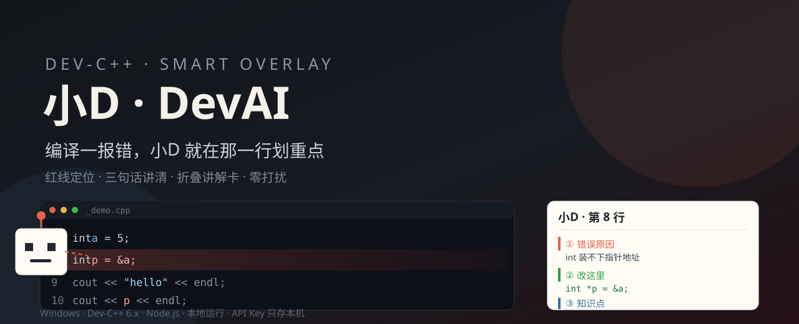
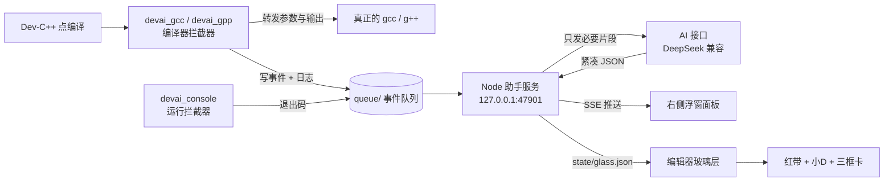

<div align="center">



# 小D · DevAI

**给 Dev-C++ 贴一层会讲人话的玻璃。**

编译一报错，小D 就在出错那一行划红线，用三个框讲清「为什么错 / 改哪里 / 记住什么」——
不切窗口、不打断思路、不堆日志。

[](https://github.com/Qs277/devai-devcpp)
[](https://github.com/Qs277/devai-devcpp)
[](https://nodejs.org)
[](LICENSE)

</div>

---

## 为什么做这个

用 Dev-C++ 写 C/C++ 的新手，最常见的三个卡点是：

| 卡点 | 现状 | 小D 的做法 |
| --- | --- | --- |
| 报错看不懂 | `invalid conversion from 'int*' to 'int'` 一行英文 | 翻译成一句人话：`int` 装不下一个地址 |
| 找不到哪一行 | 在 500 行里翻编译日志 | 直接在编辑器那一行画红带，小D 的虚线手指着它 |
| 改完就忘 | 下次同一个错再犯 | ③ 知识点：先讲「为什么」，再给一句能记住的口诀 |

它不是在 Dev-C++ 外面再开一个窗口，而是**盖在 Dev-C++ 上面的一层透明玻璃**——
你还是在原来的编辑器里写代码，只是多了一个随叫随到的同桌。

---

## 三个核心画面

**① 编辑器上的玻璃层（主舞台）**

- 出错行整行淡红高亮，左边一条实心红边；
- 小D 站在行号栏旁边，虚线手臂指向这一行，右上角 `第 8 行` 标签；
- 高亮行**下方**弹出讲解卡：三个框、带改后代码块，标题栏可**折叠**、可**拖动**；
- 位置随 Dev-C++ 滚动/移动自动跟随；Dev-C++ 不在前台时自动收起，不盖别的软件。

**② 右侧浮窗面板（安静的状态栏）**

- 顶部只留一行：当前状态 + 上一次分析的结论，**不堆历史、不刷屏**；
- 讲解卡固定三框：`① 错误原因` → `② 具体改这里（+改后代码）` → `③ 知识点与技巧`。

**③ 底部「编译日志 / 运行结果」玻璃条**

- 编译失败时，在底部日志区再贴一条玻璃，直接写一句结论；
- 展开日志面板时自动出现；面板收起时自动隐藏，不占地方。

---

## 安装（3 步，不会动你的代码）

> 需要：Windows 10/11、[Dev-C++ 6.x](https://github.com/Embarcadero/Dev-Cpp)、[Node.js 18+](https://nodejs.org)

1. 下载 [Release 包](https://github.com/Qs277/devai-devcpp/releases/latest) 并解压到任意目录（**不要**解压到 C 盘根目录或中文路径下）；
2. 双击 **`安装 DevAI.bat`**（右键 → 以管理员身份运行更稳）；
3. 用桌面上生成的 **`启动 Dev-C++ 智能版.bat`** 打开 Dev-C++，然后在面板「设置」里填你自己的 API Key。

安装器会做这些事（每一步都会备份，可完整还原）：

```
检测本机 Dev-C++ 安装位置
  └─ 备份原来的 gcc.exe / g++.exe / ConsolePauser.exe
  └─ 放入拦截器 devai_gcc.exe / devai_gpp.exe / devai_console.exe
  └─ 部署后台服务 server/ + 面板 + 玻璃层
  └─ 生成启动器与安装状态（install-state.json）
```

默认安装到 `D:\devai`（没有 D 盘时自动落到 `%LOCALAPPDATA%\DevAI`），
也可以用 `install.ps1 -DevAIHome "E:\tools\DevAI"` 指定任意路径。

卸载：双击 **`卸载 DevAI.bat`**，会把备份的原始编译器原样放回去。

---

## 它怎么工作



- **拦截器**用 C 写，只是透明转发，绝不改写你的编译命令；
- **后台服务**零第三方依赖（纯 Node 标准库），只监听 `127.0.0.1`；
- **玻璃层**是 C + Win32 分层窗口（逐像素 Alpha），点击穿透，不抢焦点；
- 编译通过时**不调用 AI**；同一个错误签名只分析一次；输出限制在 300 字内，省 token。

---

## 隐私与安全（重要）

- 🔑 **API Key 只存在本机的 `config.json`**，不写进仓库、不上传、不发给除 AI 接口以外的任何地方；
- 仓库里**没有**任何预置 Key、账号、个人路径；首次运行必须自己填；
- 日志与状态只落在本机 `state/`、`queue/`，已被 `.gitignore` 挡在版本库外；
- 只监听 `127.0.0.1`，不对外开放端口；
- 发给 AI 的只有：报错文本、出错那几行代码、编译目标文件名——**整份工程不会上传**。

> 想换模型/中转站：在面板「设置」里改 `API Base` 与 `模型名` 即可，任何 OpenAI 兼容接口都能用。

---

## 常见问题

**Q：装完打开 Dev-C++ 没反应？**
先看右下角有没有小助手的托盘图标；没有就用「打开助手面板.bat」手动拉起，或检查 Node 是否在 PATH 里（安装器会把路径写进 `node_path.txt`）。

**Q：玻璃层不出现？**
玻璃层只在 Dev-C++ 是当前窗口时显示；如果被最小化或被别的窗口挡住，它会自动收起。

**Q：底部玻璃条没有？**
它需要底部「编译日志」面板处于展开状态；收起时没有空白区，会自动隐藏。

**Q：会不会改坏我的 Dev-C++？**
所有被替换的文件都在 `backup/` 里留了原件，卸载即还原；安装器不改注册表、不改系统 PATH。

**Q：能不能用于其他 IDE？**
拦截器 + 事件队列的思路是通用的，目前只内置了 Dev-C++ 的接入；欢迎提交 PR 适配 Code::Blocks / VS Code。

---

## 目录结构

```
devai-plugin/
├─ bin/                 # 拦截器、面板宿主、玻璃层（已编译好）
├─ src/                 # devai_cc.c 编译器拦截 / devai_console.c 运行拦截
│                       # devai_dock.c 面板宿主 / devai_glass.c 透明玻璃层
├─ server/
│  ├─ server.js         # 零依赖 Node 服务（SSE + AI 编排 + 状态落盘）
│  └─ ui/index.html     # 浮窗面板（单文件）
├─ install.ps1          # 自动检测 + 部署 + 备份
├─ uninstall.ps1        # 还原
├─ 安装 DevAI.bat / 卸载 DevAI.bat
└─ docs/banner.svg
```

---

## 参与

- 发现误判行号：附上 Dev-C++ 版本、字号、缩放比例（100%/125%/150%）；
- 想要新的讲解语言/模型：改 `server.js` 里的 `SYS_DIAG` 即可；
- 只接受「不改用户编译命令、不上传源码」的改动。

## License

[MIT](LICENSE) © 2026 DevAI contributors

<div align="center">

**写代码已经够累了，报错至少应该说人话。**

</div>

---

<details>
<summary>English</summary>

**DevAI (小D)** is a Windows overlay for Dev-C++ 6.x that turns a compiler error into three plain-language panels —
*why it failed*, *what to change (with fixed code)*, *what to remember* — and highlights the exact failing line
directly inside the editor, without leaving the IDE.

It ships as a compiler-wrapper (`devai_gcc` / `devai_gpp`), a run-wrapper, a zero-dependency Node service on
`127.0.0.1:47901`, and a per-pixel-alpha Win32 overlay window. Nothing is uploaded except the error text and the
few lines around it. Your API key lives in a local `config.json` that is git-ignored.

MIT licensed. PRs for other IDEs are welcome.

</details>
