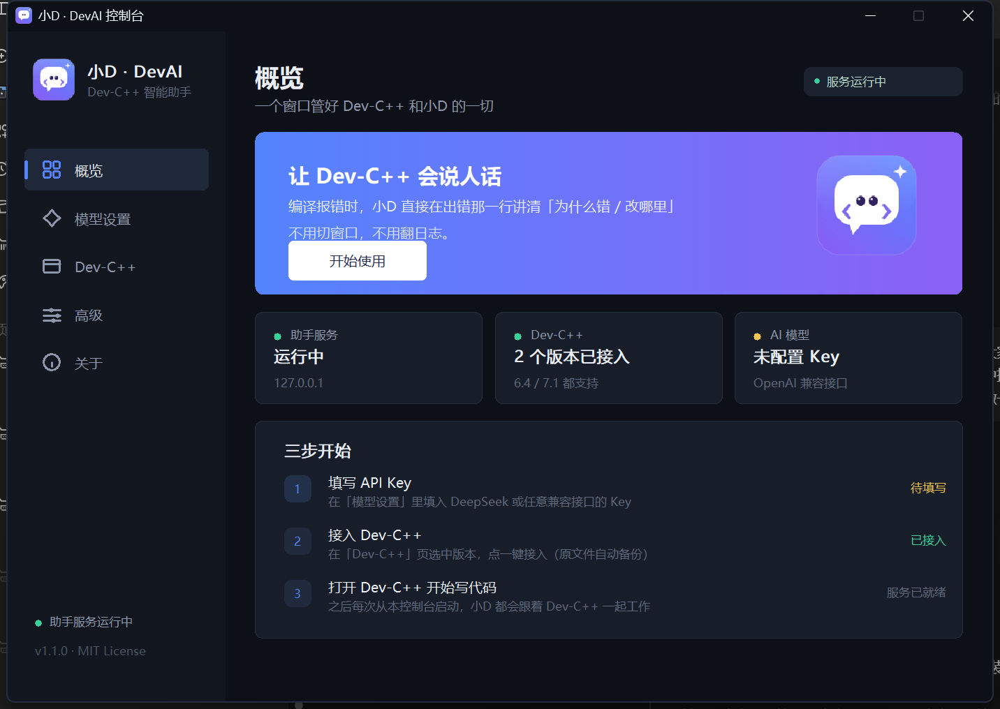
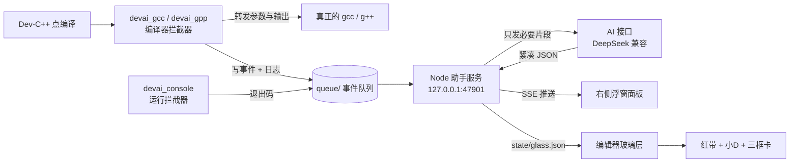

<div align="center">


# 小D · DevAI

**给 Dev-C++ 贴一层会讲人话的玻璃。**

编译一报错，小D 就在出错那一行划红线，用三个框讲清「为什么错 / 改哪里 / 记住什么」——
不切窗口、不打断思路、不堆日志。

[](https://github.com/Qs277/devai-devcpp)
[](https://github.com/Qs277/devai-devcpp)
[](https://nodejs.org)
[](LICENSE)

</div>

---

## 为什么做这个

用 Dev-C++ 写 C/C++ 的新手，最常见的三个卡点是：

| 卡点 | 现状 | 小D 的做法 |
| --- | --- | --- |
| 报错看不懂 | `invalid conversion from 'int*' to 'int'` 一行英文 | 翻译成一句人话：`int` 装不下一个地址 |
| 找不到哪一行 | 在 500 行里翻编译日志 | 直接在编辑器那一行画红带，小D 的虚线手指着它 |
| 改完就忘 | 下次同一个错再犯 | ③ 知识点：先讲「为什么」，再给一句能记住的口诀 |

它不是在 Dev-C++ 外面再开一个窗口，而是**盖在 Dev-C++ 上面的一层透明玻璃**——
你还是在原来的编辑器里写代码，只是多了一个随叫随到的同桌。

---

## 中控台

一个窗口管好所有东西：填 Key、扫版本、接入 / 还原、启动。纯 C + Win32 自绘，x64 / x86 两个版本。



---

## 三个核心画面

**① 编辑器上的玻璃层（主舞台）**

- 出错行整行淡红高亮，左边一条实心红边；
- 小D 站在行号栏旁边，虚线手臂指向这一行，右上角 `第 8 行` 标签；
- 讲解卡自动贴到**出错那行右侧的空白处**（放不下就收进编辑区内），内容**默认展开**，
  点标题栏才折叠；滚轮上下滚时卡片是**平滑滑过去**跟着走，不会闪一下再瞬移；
- 位置随 Dev-C++ 滚动/移动自动跟随；Dev-C++ 不在前台时自动收起，不盖别的软件。

**② 右侧浮窗面板（安静的状态栏）**

- 顶部只留一行：当前状态 + 上一次分析的结论，**不堆历史、不刷屏**；
- 讲解卡固定三框：`① 错误原因` → `② 具体改这里（+改后代码）` → `③ 知识点与技巧`。

**③ 没有错误的时候**

- 不划红带、不弹卡片，只在代码区的空白处放一颗绿色小药丸：
  **`代码正常，请运行测试`**；
- 当前画面里没有标出行时，红带和讲解卡一律收起，绝不乱标到别的行上。

---

## 下载即用（单文件版，推荐）

> 需要：Windows 10/11、[Dev-C++ 6.4 或 7.1](https://github.com/Embarcadero/Dev-Cpp)
> **不需要单独装 Node.js**——运行时已经打包在 exe 里。

1. 到 [Release 页面](https://github.com/Qs277/devai-devcpp/releases/latest) 下载 **`DevAI-v1.1.3-x64.exe`**
   （极老的 32 位系统用 `-x86`）；
2. 双击运行。首次启动会把运行组件释放到 `%LOCALAPPDATA%\DevAI`，只需要几秒；
3. 在中控台里：
   - **模型设置**：填 API Key（DeepSeek 或任意 OpenAI 兼容接口），点「保存设置」；
   - **Dev-C++**：会自动扫描本机所有版本，选一个点「一键接入」（也可以「浏览…」手动选目录）；
   - **概览**：点「开始使用」，Dev-C++、助手服务和玻璃层会一起拉起来。

第一次运行时中控台会请求管理员权限，用来替换 Dev-C++ 里的 `gcc / g++ / ConsolePauser`
（原件会自动备份，随时可以在「Dev-C++」页点「移除接入」还原）。

**绿色版**：把 `portable.txt` 放在 exe 旁边，数据就写到 `exe 所在目录\DevAI-Data`，不碰 `%LOCALAPPDATA%`。

<details>
<summary>不想用单文件版？用脚本方式安装也可以</summary>

1. 下载源码包并解压到任意目录（**不要**解压到 C 盘根目录或中文路径下）；
2. 双击 **`安装 DevAI.bat`**（右键 → 以管理员身份运行更稳）；
3. 用开始菜单里生成的 **`Dev-C++ 智能版`** 快捷方式（或 `启动 Dev-C++ 智能版.bat`）打开 Dev-C++。

装了多个 Dev-C++（6.4 + 7.1 共存）？安装器会自动扫描全部并逐个接好，只生成**一个**启动器；
只想接指定的那一个：`安装 DevAI.bat -DevCppRoot "D:\某目录\Dev-Cpp"`。

卸载：双击 **`卸载 DevAI.bat`**，会把备份的原始编译器原样放回去。

</details>

---

## 它怎么工作



- **拦截器**用 C 写，只是透明转发，绝不改写你的编译命令；
- **后台服务**零第三方依赖（纯 Node 标准库），只监听 `127.0.0.1`；
- **玻璃层**是 C + Win32 分层窗口（逐像素 Alpha），点击穿透，不抢焦点；
- 编译通过时**不调用 AI**；同一个错误签名只分析一次；输出限制在 300 字内，省 token。

---

## 隐私与安全（重要）

- 🔑 **API Key 只存在本机的 `config.json`**，不写进仓库、不上传、不发给除 AI 接口以外的任何地方；
- 仓库里**没有**任何预置 Key、账号、个人路径；首次运行必须自己填；
- 日志与状态只落在本机 `state/`、`queue/`，已被 `.gitignore` 挡在版本库外；
- 只监听 `127.0.0.1`，不对外开放端口；
- 发给 AI 的只有：报错文本、出错那几行代码、编译目标文件名——**整份工程不会上传**。

> 想换模型/中转站：在面板「设置」里改 `API Base` 与 `模型名` 即可，任何 OpenAI 兼容接口都能用。

---

## 常见问题

**Q：需要自己装 Node.js 吗？**
不用。单文件版已经内嵌了 Node 运行时和全部组件；只有用脚本方式安装时，才会去找系统里的 Node。

**Q：装完打开 Dev-C++ 没反应？**
先看右下角有没有小助手的托盘图标；没有就回到中控台点「开始使用」，或检查 `%LOCALAPPDATA%\DevAI\devai-install.log`。

**Q：玻璃层不出现？**
玻璃层只在 Dev-C++ 是当前窗口时显示；如果被最小化或被别的窗口挡住，它会自动收起。

**Q：红带/讲解卡有时候不出现？**
当前画面里看不到出错那一行时（比如滚到别处了）就会收起——只标你看得见的那一行，不硬标到旁边去。

**Q：6.4 和 7.1 都能用吗？**
都能用。两个版本的行号栏与滚动条实现不一样，玻璃层会分别识别，标行位置按真实行号算，滚轮跟手。

**Q：会不会改坏我的 Dev-C++？**
所有被替换的文件都在 `backup/` 里留了原件，卸载即还原；安装器不改注册表、不改系统 PATH。

**Q：能不能用于其他 IDE？**
拦截器 + 事件队列的思路是通用的，目前只内置了 Dev-C++ 的接入；欢迎提交 PR 适配 Code::Blocks / VS Code。

---

## 目录结构

```
devai-plugin/
├─ src/
│  ├─ devai_center.c    # 单文件版中控台（纯 C + Win32 自绘，x64 / x86 同一份源码）
│  ├─ devai_cc.c        # 编译器拦截器（编译成 devai_gcc / devai_gpp）
│  ├─ devai_console.c   # 运行拦截器
│  ├─ devai_dock.c      # 面板宿主
│  └─ devai_glass.c     # 透明玻璃层
├─ res/                 # center.rc / 图标 / manifest
├─ tools/
│  ├─ build-release.ps1 # 一键产出 dist\DevAI-v1.1.3-x64.exe / -x86.exe
│  └─ build-icon.ps1    # 生成多尺寸图标
├─ bin/                 # 拦截器、面板宿主、玻璃层（已编译好）
├─ server/
│  ├─ server.js         # 零依赖 Node 服务（SSE + AI 编排 + 状态落盘）
│  └─ ui/index.html     # 浮窗面板（单文件）
├─ install.ps1          # 自动检测 + 部署 + 备份
├─ launcher.ps1         # 启动器：扫描本机所有 Dev-C++，弹窗选版本后一起拉起
├─ uninstall.ps1        # 还原
├─ 安装 DevAI.bat / 卸载 DevAI.bat
└─ docs/banner.svg
```

单文件版的原理：`payload.zip`（node.exe + 组件，Deflate 压缩后 33.5 MB）作为 RCDATA 资源编进 exe，
首次运行用系统自带的 `tar.exe` 解包到数据目录，之后启动只做版本戳比对。

---

## 参与

- 发现误判行号：附上 Dev-C++ 版本、字号、缩放比例（100%/125%/150%）；
- 想要新的讲解语言/模型：改 `server.js` 里的 `SYS_DIAG` 即可；
- 只接受「不改用户编译命令、不上传源码」的改动。

## License

[MIT](LICENSE) © 2026 DevAI contributors

<div align="center">

**写代码已经够累了，报错至少应该说人话。**

</div>

---

<details>
<summary>English</summary>

**DevAI (小D)** is a Windows overlay for Dev-C++ 6.4 / 7.1 that turns a compiler error into three plain-language panels —
*why it failed*, *what to change (with fixed code)*, *what to remember* — and highlights the exact failing line
directly inside the editor, without leaving the IDE.

It ships as a compiler-wrapper (`devai_gcc` / `devai_gpp`), a run-wrapper, a zero-dependency Node service on
`127.0.0.1:47901`, and a per-pixel-alpha Win32 overlay window. Nothing is uploaded except the error text and the
few lines around it. Your API key lives in a local `config.json` that is git-ignored.

MIT licensed. PRs for other IDEs are welcome.

</details>
